# Chordarium HUB

[](https://chordarium.lapalu.me)
[](https://chordariumchorder.lapalu.me)
[](LICENSE)

**Chordarium** is a music lab by [Lapalu Liyanage](https://github.com/LapaluLiyanage): chord tools for people who play. This repository is the hub site. It introduces the tools, hosts the interactive **Chordarium Ring**, and carries a live music-news page.

## Live links

| | |
|---|---|
| **Chordarium hub** | https://chordarium.lapalu.me |
| **Chorder** (YouTube link or MP3 to synced chords) | https://chordariumchorder.lapalu.me |
| **Setsmith** (finished setlist planner for live bands, first used by FASTUNES at RUSL) | https://setsmith.lapalu.me ([source](https://github.com/LapaluLiyanage/setsmith)) |

## Screenshots

### Home

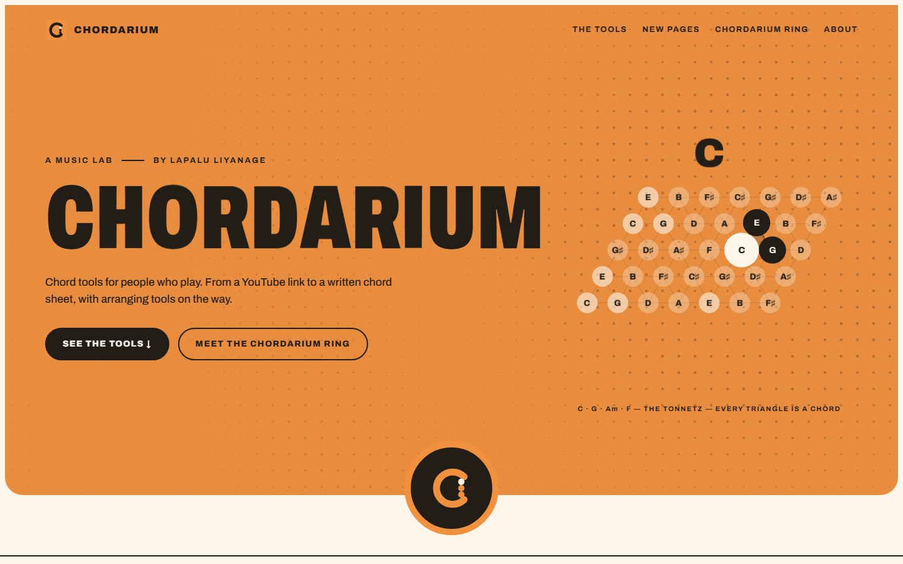

### The tools

Chorder is working and Setsmith is finished. Studio and Songbooks are on the way.

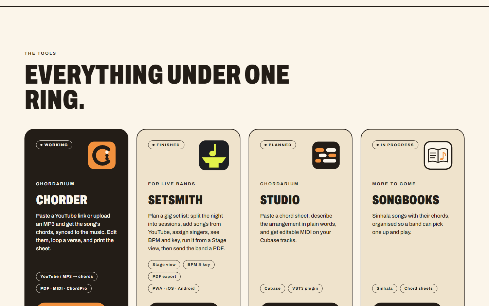

### The Chordarium Ring

An interactive circle of notes. Drag it, tap a note, or pick a chord to hear and see how it is built.

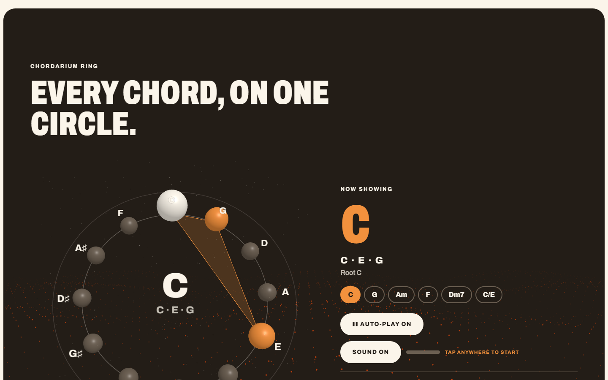

### Music News

Headlines from the music world and from five countries, with images, search, sorting and filters.

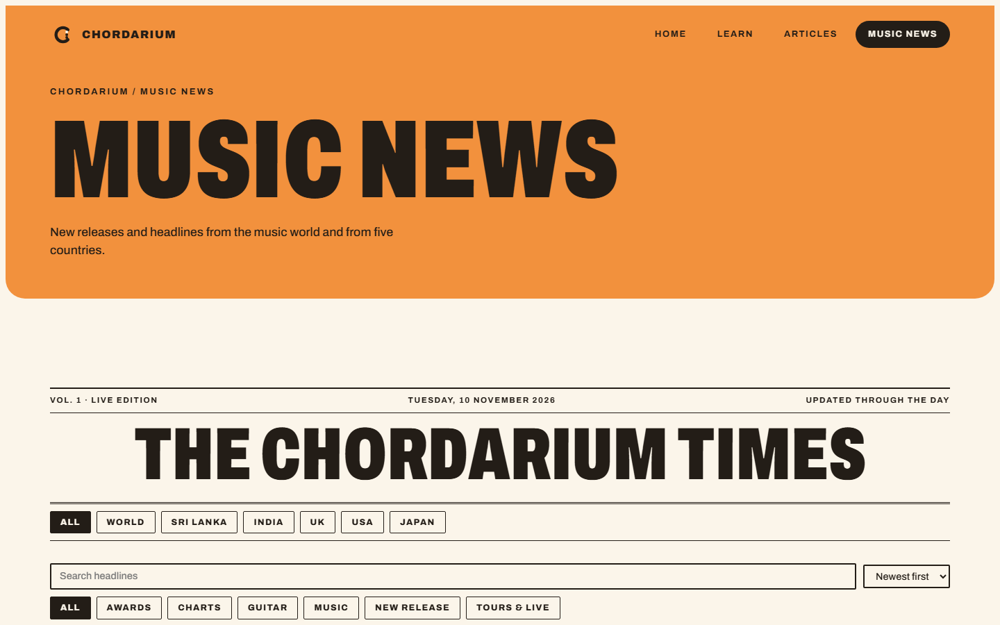

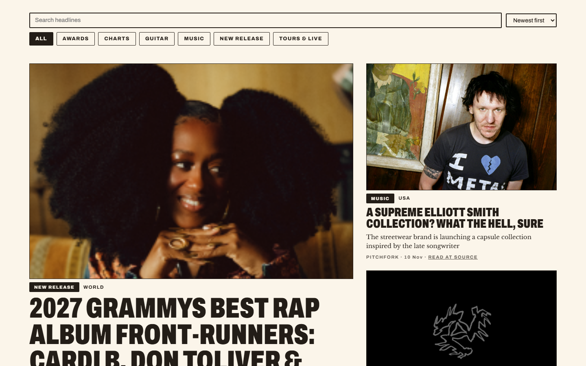

### Learn and Articles

| Learn | Articles |
|---|---|
| 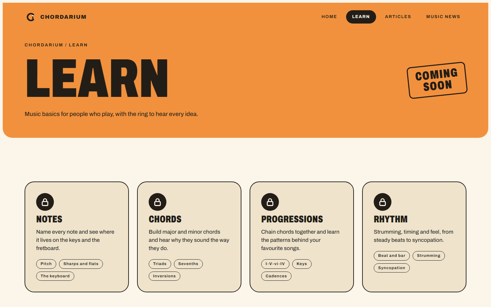 | 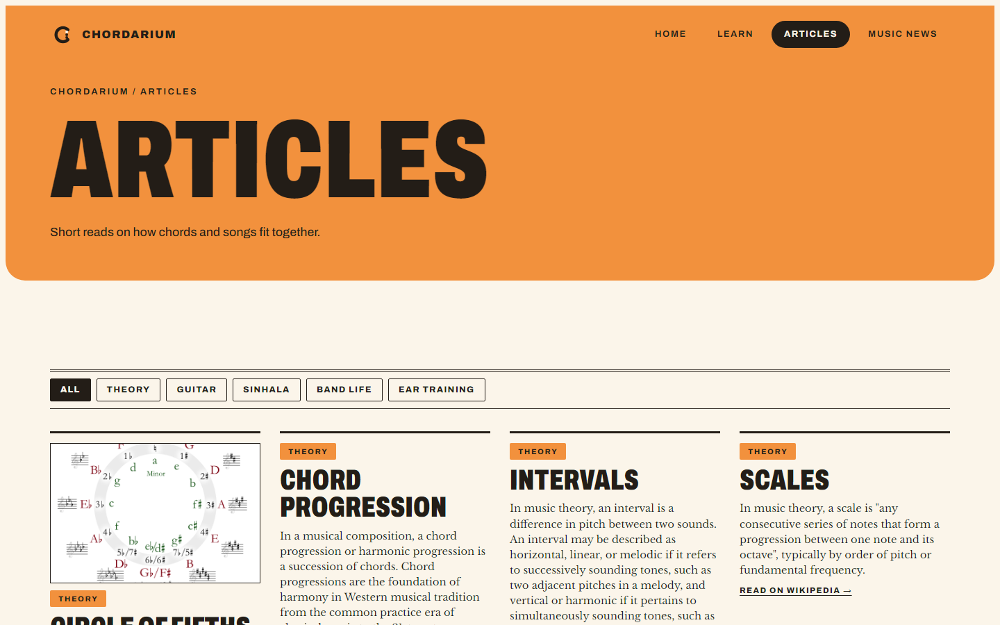 |

### Mobile

The site is responsive down to small phones. The screenshots below are at 390 px wide.

| Home | Tools | Ring | News |
|---|---|---|---|
| 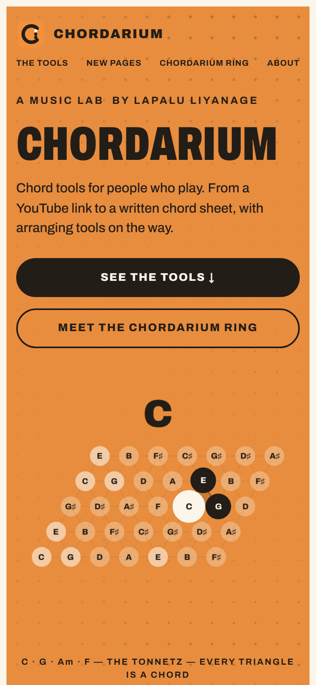 | 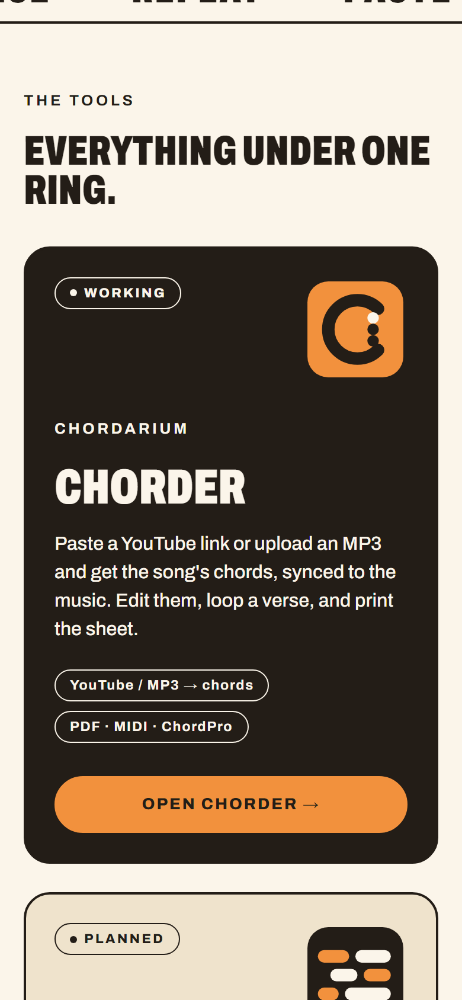 | 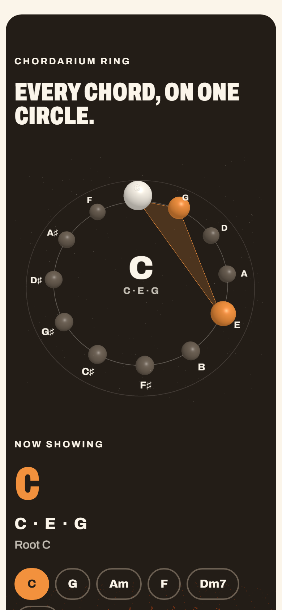 | 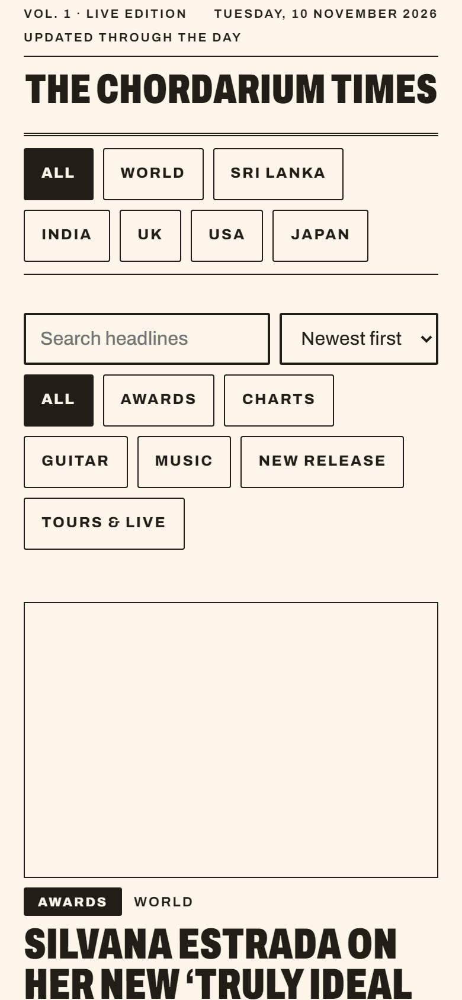 |

## Features

- **Hero and dot fields**: three.js backdrops and a Tonnetz lattice where every triangle is a chord.
- **Chordarium Ring**: a 3D ring of the twelve notes with chord chips, auto-play and Web Audio sound. It falls back to a flat SVG ring when WebGL is off.
- **Music News**: `/api/news` is a serverless function that reads RSS feeds from Billboard, Stereogum, Pitchfork, The Guardian, NME, Rolling Stone and more, plus Google News searches for Sri Lanka, India, the UK, the USA and Japan. It shows only the last 7 days.
- **Articles API**: `GET /api/articles` returns the article list and topics as JSON. Filter with `?tag=THEORY` or search titles with `?q=chords`. The Articles page loads from it and falls back to a built-in list.
- **Learn** and **Articles**: sections in progress.
- Smooth scrolling, grain texture, scroll reveals and reduced-motion support.

## Tech stack

React 19, TypeScript, Vite, React Router, three.js, GSAP, Lenis. Tests use Vitest and Playwright. It is deployed on Vercel.

## Getting started

```bash
git clone https://github.com/LapaluLiyanage/Chordarium-HUB.git
cd Chordarium-HUB
npm install
npm run dev        # http://localhost:5173, /api/news is served in dev too
```

| Command | What it does |
|---|---|
| `npm run dev` | Start the Vite dev server |
| `npm run build` | Type-check and build to `dist/` |
| `npm run preview` | Serve the production build locally |
| `npm test` | Unit tests (Vitest) |
| `npm run e2e` | End-to-end smoke tests (Playwright) |

## Project structure

```
api/news.ts          Vercel function behind /api/news
api/articles.ts      Vercel function behind /api/articles
src/pages/           Home, Learn, Articles, News
src/components/      Ring, hero lattice, nav, news cards, backdrops
src/data/            Projects, feeds, modules, articles
src/lib/             Music theory, RSS parsing, audio, motion, scrolling
e2e/                 Playwright smoke tests
docs/screenshots/    Images used in this README
```

## License

The source code of this project is released under the **[MIT License](LICENSE)**. Copyright (c) 2026 Lapalu Liyanage. You may use, copy, modify, merge, publish, distribute, sublicense and sell it, provided the copyright and licence notice stay in all copies. It comes with no warranty.

The MIT licence covers this repository's own code, text and design. It does **not** cover the third-party material below, which keeps its own terms.

### Third-party software

| Package | Licence |
|---|---|
| React, React DOM, React Router | MIT |
| three.js | MIT |
| Lenis | MIT |
| [GSAP](https://gsap.com) | GSAP "Standard No Charge" licence. It is free to use, but it is not MIT and it restricts building tools that compete with GSAP's own. Read the [GSAP licence](https://gsap.com/standard-license) before redistributing or commercialising. |
| Vite, Vitest, Playwright, TypeScript, Testing Library | MIT or Apache-2.0 (development tools, not shipped) |

Full licence texts are in each package's folder under `node_modules/` after `npm install`.

### Fonts

[Archivo](https://fonts.google.com/specimen/Archivo) and [Libre Baskerville](https://fonts.google.com/specimen/Libre+Baskerville) are loaded from Google Fonts and licensed under the SIL Open Font License 1.1.

### News content

Headlines, summaries and images on the Music News page are fetched live from the publishers' public RSS feeds. They are **not** part of this project and are not covered by the MIT licence. Each belongs to its publisher (Billboard, Pitchfork, Stereogum, The Guardian, NME, Rolling Stone, Google News and others). Every story links back to its source. Nothing is stored or redistributed by this repository.

### Chordarium name and logos

The Chordarium name, the Ring mark and the project logos are the creative identity of Lapalu Liyanage. You may fork the code, but please do not present a fork as the official Chordarium or reuse the name and logos for another product.

## Author

**Lapalu Liyanage**: software engineering student at Rajarata University of Sri Lanka, rhythm guitarist, President of the Fastunes Music Society.

- GitHub: [@LapaluLiyanage](https://github.com/LapaluLiyanage)
- Site: [chordarium.lapalu.me](https://chordarium.lapalu.me)
